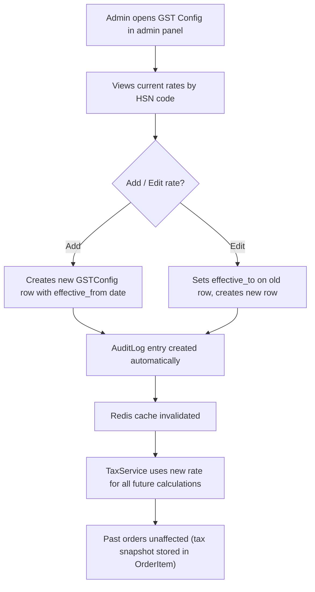

# Phase 1 — Architecture Plan v2 (FINAL)
# Elorah Jewelry — Production E-Commerce Platform

> **Status:** UPDATED — All decisions confirmed. Awaiting final go-ahead for Phase 2.

---

## Confirmed Decisions

| Decision | Answer |
|---|---|
| Database | **PostgreSQL 16** (all environments) |
| Brand Name | **Elorah Jewelry** |
| Seller State | **Kerala** |
| GST | **Fully admin-configurable** — rates, HSN codes, rules all managed from admin panel |
| Pricing | Gold/Silver/Platinum = **DYNAMIC**; Imitation/accessories = **FIXED** |
| GST rate default | 3% gold/silver (HSN 7113), 5% imitation (HSN 7117) — **admin can change anytime** |
| GST on making charges | Combined (3% on total) — **admin can reconfigure** |
| Guest checkout | **Yes** |
| COD max | **₹50,000** (admin-configurable) |
| Free shipping | Above **₹2,000** (admin-configurable) |
| Shipping model | **Zone-based flat rate** (configurable) |
| Cancellation | Customer can cancel before PROCESSING; admin can cancel anytime |
| Returns | 7 days, admin approval required |
| Refunds | To original payment method; COD via bank transfer |
| Min order value | None |
| Max qty per product | 5 per order |
| Coupon stacking | One coupon per order |
| Image storage | **Cloudinary** |
| Email | **Gmail SMTP** initially (architecture supports switch) |
| Domain | Env var placeholder |

---

## A — Architecture Overview

*(Unchanged from v1 — see original plan for system diagram, request flow, and full dependency list. Only additions below.)*

### Additional Dependencies (Updated)

| Package | Purpose |
|---|---|
| psycopg[binary] ~=3.2 | PostgreSQL adapter (replaces any MySQL ref) |
| cloudinary ~=1.41 | Cloudinary SDK |
| django-cloudinary-storage ~=0.3 | Django integration |

### Removed
- `mysqlclient` — we're using PostgreSQL

---

## B — Enhanced Folder Structure (Security-Hardened)

Changes from v1 are marked with `# ← NEW` or `# ← CHANGED`.

```
elorah_jewelry/
├── manage.py
│
├── config/
│   ├── __init__.py
│   ├── settings/
│   │   ├── __init__.py
│   │   ├── base.py                 # Shared settings
│   │   ├── development.py          # Dev overrides
│   │   ├── production.py           # Prod overrides (strict security)
│   │   └── security.py             # ← NEW: Security-specific settings
│   │                               #   CSP directives, rate-limit configs,
│   │                               #   session config, password validators,
│   │                               #   security header values — all in one
│   │                               #   auditable file
│   ├── urls/                       # ← CHANGED: Split URL routing
│   │   ├── __init__.py             #   Root urlconf (imports public + internal)
│   │   ├── public.py              #   Customer-facing: catalog, cart, checkout
│   │   ├── internal.py            #   Admin panel (env-configured URL prefix)
│   │   └── webhooks.py            #   Payment webhooks (separate, rate-limited,
│   │                               #   hard-to-guess URL path from env)
│   ├── wsgi.py
│   ├── asgi.py
│   └── celery.py
│
├── apps/
│   ├── __init__.py
│   │
│   ├── accounts/
│   │   ├── __init__.py
│   │   ├── apps.py
│   │   ├── models.py              # CustomUser, UserProfile, Address
│   │   ├── managers.py            # CustomUserManager (email-based)
│   │   ├── forms.py
│   │   ├── views.py
│   │   ├── urls.py
│   │   ├── services.py            # Auth, merge cart, verification, 2FA setup
│   │   ├── selectors.py
│   │   ├── signals.py
│   │   ├── validators.py          # Password strength, phone format
│   │   ├── middleware.py          # Last-activity, failed-login tracking
│   │   ├── admin.py
│   │   ├── decorators.py
│   │   ├── templatetags/
│   │   │   └── account_tags.py
│   │   ├── templates/accounts/
│   │   ├── tests/
│   │   │   ├── __init__.py
│   │   │   ├── test_models.py
│   │   │   ├── test_views.py
│   │   │   ├── test_services.py
│   │   │   ├── test_permissions.py
│   │   │   ├── test_idor.py       # ← NEW: Dedicated IDOR tests
│   │   │   └── factories.py
│   │   └── migrations/
│   │
│   ├── catalog/
│   │   ├── __init__.py
│   │   ├── apps.py
│   │   ├── models.py              # Category, Product, ProductVariant,
│   │   │                          # ProductImage, Material, Purity,
│   │   │                          # StockRecord, AttributeDefinition,
│   │   │                          # AttributeValue
│   │   ├── managers.py
│   │   ├── forms.py
│   │   ├── views.py
│   │   ├── urls.py
│   │   ├── services.py            # Stock mgmt, image processing
│   │   ├── selectors.py           # Optimized queries (select/prefetch)
│   │   ├── filters.py             # django-filter filtersets
│   │   ├── signals.py
│   │   ├── image_utils.py         # Upload validation, re-encode, WebP
│   │   ├── admin.py
│   │   ├── sitemaps.py
│   │   ├── templatetags/
│   │   │   └── catalog_tags.py
│   │   ├── templates/catalog/
│   │   ├── tests/
│   │   │   ├── __init__.py
│   │   │   ├── test_models.py
│   │   │   ├── test_views.py
│   │   │   ├── test_selectors.py
│   │   │   ├── test_image_utils.py
│   │   │   └── factories.py
│   │   └── migrations/
│   │
│   ├── pricing/
│   │   ├── __init__.py
│   │   ├── apps.py
│   │   ├── models.py              # MetalRate, TaxConfig, TaxRule,
│   │   │                          # ShippingZone, ShippingRate,
│   │   │                          # PincodeServiceability, GSTConfig
│   │   ├── services.py            # PricingService, TaxService,
│   │   │                          # ShippingService
│   │   ├── selectors.py           # Rate lookups with Redis caching
│   │   ├── admin.py               # ← Full admin UI for all rates/tax/GST
│   │   ├── views.py               # Pincode check (HTMX)
│   │   ├── urls.py
│   │   ├── templatetags/
│   │   │   └── pricing_tags.py    # INR formatting, tax display
│   │   ├── templates/pricing/
│   │   ├── tests/
│   │   │   ├── __init__.py
│   │   │   ├── test_services.py
│   │   │   ├── test_models.py
│   │   │   └── factories.py
│   │   └── migrations/
│   │
│   ├── cart/
│   │   ├── __init__.py
│   │   ├── apps.py
│   │   ├── models.py              # Cart, CartItem
│   │   ├── services.py            # CartService (add/remove/merge/totals)
│   │   ├── selectors.py
│   │   ├── views.py
│   │   ├── urls.py
│   │   ├── context_processors.py  # Cart count globally
│   │   ├── middleware.py          # Session cart init
│   │   ├── templatetags/
│   │   │   └── cart_tags.py
│   │   ├── templates/cart/
│   │   ├── tests/
│   │   │   ├── __init__.py
│   │   │   ├── test_services.py
│   │   │   ├── test_views.py
│   │   │   ├── test_tamper.py     # ← NEW: Price/qty tampering tests
│   │   │   └── factories.py
│   │   └── migrations/
│   │
│   ├── orders/
│   │   ├── __init__.py
│   │   ├── apps.py
│   │   ├── models.py              # Order, OrderItem, OrderStatusLog,
│   │   │                          # OrderAddressSnapshot
│   │   ├── services.py            # OrderService, InvoiceService
│   │   ├── state_machine.py       # Valid transitions, enforce rules
│   │   ├── selectors.py
│   │   ├── views.py
│   │   ├── urls.py
│   │   ├── admin.py
│   │   ├── signals.py
│   │   ├── tasks.py               # Celery: invoice PDF, emails
│   │   ├── templatetags/
│   │   │   └── order_tags.py
│   │   ├── templates/orders/
│   │   │   └── invoice_template.html  # WeasyPrint GST invoice
│   │   ├── tests/
│   │   │   ├── __init__.py
│   │   │   ├── test_services.py
│   │   │   ├── test_state_machine.py
│   │   │   ├── test_views.py
│   │   │   ├── test_snapshots.py  # ← NEW: Snapshot integrity tests
│   │   │   └── factories.py
│   │   └── migrations/
│   │
│   ├── payments/
│   │   ├── __init__.py
│   │   ├── apps.py
│   │   ├── models.py              # Payment, PaymentEvent, WebhookEvent
│   │   ├── gateway/
│   │   │   ├── __init__.py
│   │   │   ├── base.py            # Abstract PaymentGateway interface
│   │   │   ├── razorpay.py        # Razorpay implementation
│   │   │   └── factory.py         # Gateway factory/registry
│   │   ├── services.py            # PaymentService (orchestrator)
│   │   ├── webhooks.py            # Webhook handler + sig verification
│   │   ├── views.py               # Payment initiation, callback
│   │   ├── urls.py                # Only callback; webhooks in config/urls/webhooks.py
│   │   ├── admin.py
│   │   ├── tasks.py               # Celery: release stuck payments
│   │   ├── templates/payments/
│   │   ├── tests/
│   │   │   ├── __init__.py
│   │   │   ├── test_services.py
│   │   │   ├── test_webhooks.py   # Tampered sig, replay, idempotency
│   │   │   ├── test_gateway.py
│   │   │   └── factories.py
│   │   └── migrations/
│   │
│   ├── promotions/
│   │   ├── __init__.py
│   │   ├── apps.py
│   │   ├── models.py              # Coupon, CouponUsage, Banner
│   │   ├── services.py            # CouponService (validate, abuse checks)
│   │   ├── views.py
│   │   ├── urls.py
│   │   ├── admin.py
│   │   ├── templatetags/
│   │   │   └── promo_tags.py
│   │   ├── templates/promotions/
│   │   ├── tests/
│   │   │   ├── __init__.py
│   │   │   ├── test_services.py
│   │   │   └── factories.py
│   │   └── migrations/
│   │
│   ├── wishlist/
│   │   ├── __init__.py
│   │   ├── apps.py
│   │   ├── models.py
│   │   ├── views.py
│   │   ├── urls.py
│   │   ├── services.py
│   │   ├── templates/wishlist/
│   │   ├── tests/
│   │   └── migrations/
│   │
│   ├── reviews/
│   │   ├── __init__.py
│   │   ├── apps.py
│   │   ├── models.py
│   │   ├── views.py
│   │   ├── urls.py
│   │   ├── services.py
│   │   ├── admin.py
│   │   ├── templates/reviews/
│   │   ├── tests/
│   │   └── migrations/
│   │
│   ├── notifications/
│   │   ├── __init__.py
│   │   ├── apps.py
│   │   ├── models.py             # NotificationLog
│   │   ├── services.py           # EmailService (template-based)
│   │   ├── tasks.py              # Celery tasks per notification type
│   │   ├── templates/notifications/
│   │   │   └── emails/           # HTML email templates
│   │   └── tests/
│   │
│   ├── audit/                     # ← NEW APP: Centralized audit trail
│   │   ├── __init__.py
│   │   ├── apps.py
│   │   ├── models.py             # AuditLog (who, what, when, IP, details)
│   │   ├── services.py           # AuditService.log(actor, action, target, ...)
│   │   ├── middleware.py         # Auto-capture request metadata
│   │   │                         # (IP, user-agent, request-id)
│   │   ├── signals.py            # Hook into auth, payment, order events
│   │   ├── admin.py              # Read-only admin view of audit trail
│   │   ├── mixins.py             # AuditableMixin for models
│   │   ├── constants.py          # Audit event types
│   │   ├── tests/
│   │   └── migrations/
│   │
│   └── core/
│       ├── __init__.py
│       ├── apps.py
│       ├── views.py              # Home, about, contact, legal pages, health
│       ├── urls.py
│       ├── models.py             # SiteConfig (singleton for store settings)
│       ├── mixins.py             # TimestampMixin, SlugMixin, etc.
│       ├── utils.py              # INR formatting, random filename, etc.
│       ├── validators.py         # Shared validators
│       ├── exceptions.py         # Custom exception hierarchy
│       ├── context_processors.py # Site-wide: brand, cart count, year
│       ├── middleware.py         # RequestID, security logging
│       ├── decorators.py
│       ├── management/
│       │   └── commands/
│       │       ├── seed_demo.py      # Sample data (DEBUG only)
│       │       ├── setup_groups.py   # Creates roles + permissions
│       │       └── health_check.py   # CLI health check
│       ├── sitemaps.py
│       ├── templatetags/
│       │   └── core_tags.py
│       ├── templates/core/
│       └── tests/
│
├── templates/
│   ├── base.html                  # Master layout (Elorah Jewelry branding)
│   ├── partials/
│   │   ├── _navbar.html
│   │   ├── _footer.html
│   │   ├── _messages.html
│   │   ├── _breadcrumbs.html
│   │   ├── _pagination.html
│   │   ├── _search.html
│   │   ├── _seo_meta.html
│   │   ├── _trust_badges.html    # ← NEW: Security/trust indicators
│   │   └── _cookie_consent.html  # ← NEW: GDPR/compliance
│   ├── emails/                    # ← NEW: Shared email base templates
│   │   ├── _base_email.html
│   │   └── _email_styles.html
│   ├── legal/                     # ← NEW: Legal page templates
│   │   ├── privacy_policy.html
│   │   ├── terms_conditions.html
│   │   ├── shipping_policy.html
│   │   ├── return_policy.html
│   │   └── refund_policy.html
│   └── errors/
│       ├── 400.html
│       ├── 403.html
│       ├── 404.html
│       └── 500.html
│
├── static/
│   ├── css/
│   │   ├── input.css              # Tailwind source
│   │   └── output.css             # Compiled
│   ├── js/
│   │   ├── htmx.min.js
│   │   ├── main.js
│   │   └── razorpay_checkout.js   # Payment modal handler
│   └── images/
│       ├── logo.svg
│       ├── favicon.ico
│       └── placeholders/
│
├── media/                         # Dev only; prod uses Cloudinary
│
├── tests/                         # Cross-app integration + security tests
│   ├── __init__.py
│   ├── conftest.py                # Shared pytest fixtures
│   ├── test_integration/
│   │   ├── test_checkout_flow.py
│   │   ├── test_payment_flow.py
│   │   └── test_guest_checkout.py
│   └── test_security/            # ← NEW: Dedicated security test suite
│       ├── test_idor.py           # Cross-app IDOR tests
│       ├── test_rate_limiting.py
│       ├── test_headers.py        # Security header verification
│       ├── test_csrf.py
│       ├── test_auth_enumeration.py  # Account enumeration prevention
│       └── test_file_upload.py    # Malicious upload attempts
│
├── compliance/                    # ← NEW: Legal & compliance docs
│   ├── privacy_policy.md         # Content for legal pages (you fill)
│   ├── terms_of_service.md
│   ├── shipping_policy.md
│   ├── return_refund_policy.md
│   └── cookie_policy.md
│
├── scripts/
│   ├── deploy.sh
│   ├── backup_db.sh               # With encryption support
│   ├── restore_db.sh              # Tested restore procedure
│   ├── rotate_secrets.sh          # ← NEW: Secret rotation helper
│   └── security_audit.sh          # ← NEW: Run pip-audit + check --deploy
│
├── deploy/
│   ├── nginx/
│   │   ├── nginx.conf             # Main config (worker tuning, limits)
│   │   ├── elorah.conf            # Site config (HTTPS, proxy, headers)
│   │   ├── security_headers.conf  # ← NEW: Includeable security headers
│   │   ├── rate_limiting.conf     # ← NEW: Rate limit zones
│   │   └── ssl_params.conf        # ← NEW: TLS config (ciphers, OCSP)
│   └── gunicorn.conf.py
│
├── docker/
│   ├── Dockerfile                 # Multi-stage, non-root user
│   └── docker-entrypoint.sh       # ← NEW: Entrypoint with health wait
│
├── docs/
│   ├── architecture.md
│   ├── installation.md
│   ├── environment_variables.md
│   ├── deployment.md
│   ├── payment_setup.md
│   ├── security_checklist.md
│   ├── admin_roles.md             # ← NEW: Role setup guide
│   ├── gst_configuration.md       # ← NEW: GST admin guide
│   ├── backup_restore.md          # ← NEW: Dedicated backup doc
│   ├── testing.md
│   ├── go_live_checklist.md
│   └── troubleshooting.md
│
├── requirements/
│   ├── base.txt
│   ├── development.txt
│   └── production.txt
│
├── .github/
│   └── workflows/
│       ├── ci.yml                 # pytest, check --deploy, pip-audit
│       └── security.yml           # ← NEW: Scheduled dep vulnerability scan
│
├── docker-compose.yml             # Dev: web, postgres, redis
├── docker-compose.prod.yml        # Prod: + celery, beat, nginx
├── .env.example                   # Every variable documented
├── .gitignore
├── .dockerignore
├── pytest.ini
├── pyproject.toml
├── Makefile
├── tailwind.config.js
├── SECURITY.md                    # ← NEW: Security policy / disclosure
└── README.md
```

### Key Structural Security Improvements

| Change | Why |
|---|---|
| **`config/settings/security.py`** | All security settings in one auditable file — CSP, rate limits, password validators, session config. Easy to review and audit |
| **`config/urls/` split** (public / internal / webhooks) | Webhook URLs are isolated and use a secret path prefix from env. Admin URLs are separated. Reduces attack surface per route group |
| **`apps/audit/`** (new app) | Centralized, immutable audit trail. Records: who did what, when, from where (IP), on what resource. Admin can view but not edit/delete. Critical for security forensics and compliance |
| **`tests/test_security/`** | Dedicated security test suite — IDOR, rate limiting, header checks, CSRF, account enumeration, malicious uploads. Run in CI on every push |
| **`compliance/`** | Legal content lives outside code — you fill in the `.md` files, templates render them. Clear separation of legal from code |
| **`deploy/nginx/` split** | Security headers, rate limiting, and SSL params in separate includeable files. Easier to audit, update, and share across environments |
| **`scripts/rotate_secrets.sh`** | Helper to rotate SECRET_KEY, DB password, API keys without downtime |
| **`scripts/security_audit.sh`** | One command: `pip-audit` + `check --deploy` + header checks |
| **`.github/workflows/security.yml`** | Weekly automated dependency vulnerability scan |
| **`SECURITY.md`** | Responsible disclosure policy — standard for production projects |
| **`docker/docker-entrypoint.sh`** | Waits for DB/Redis readiness, runs migrations, collects static — no manual steps on deploy |

---

## C — Database Design Updates

### New Model: `audit.AuditLog`

| Field | Type | Constraints | Notes |
|---|---|---|---|
| id | BigAutoField | PK | |
| timestamp | DateTimeField | auto_now_add, indexed | |
| actor | ForeignKey(User) | nullable, on_delete=SET_NULL | null = system/anonymous |
| actor_email | CharField(255) | blank | Snapshot (if user deleted) |
| action | CharField(50) | indexed | LOGIN_SUCCESS, ORDER_CREATED, RATE_UPDATED, etc. |
| category | CharField(30) | indexed, choices | AUTH, PAYMENT, ORDER, ADMIN, SECURITY, DATA |
| target_type | CharField(100) | blank | "Order", "Product", "MetalRate" |
| target_id | CharField(50) | blank | PK of affected object |
| target_repr | CharField(200) | blank | Human-readable: "Order JW-20261007-0001" |
| ip_address | GenericIPAddressField | nullable | |
| user_agent | CharField(300) | blank | |
| detail | JSONField | default=dict | Extra context (old value, new value, etc.) |
| severity | CharField(10) | choices: INFO/WARNING/CRITICAL | |

- **Indexes**: timestamp, actor, action, category, (category + action)
- **Admin**: Read-only — no edit, no delete permissions
- **Retention**: Configurable cleanup task (default: keep 1 year)

### Updated Model: `pricing.TaxConfig` → `pricing.GSTConfig`

Fully admin-configurable GST with history:

| Field | Type | Constraints | Notes |
|---|---|---|---|
| id | BigAutoField | PK | |
| name | CharField(100) | | "GST on Gold Jewellery", "GST on Making Charges" |
| hsn_code | CharField(8) | indexed | |
| description | TextField | blank | Admin notes |
| tax_rate | DecimalField(5,2) | CHECK >= 0, CHECK <= 100 | e.g. 3.00 |
| applies_to | CharField(20) | choices: TOTAL/METAL/MAKING/STONE | What this rate applies to |
| is_active | BooleanField | default=True | |
| effective_from | DateField | | |
| effective_to | DateField | nullable | null = no end date |
| updated_by | ForeignKey(User) | nullable, on_delete=SET_NULL | |
| created_at | DateTimeField | auto_now_add | |
| updated_at | DateTimeField | auto_now | |

- **Admin UI**: Full CRUD, with change history logged to AuditLog
- **Unique together**: (hsn_code, applies_to, effective_from)

### New Model: `core.SiteConfig` (Singleton)

Admin-editable store settings:

| Field | Type | Constraints | Notes |
|---|---|---|---|
| id | BigAutoField | PK (always = 1) | Singleton |
| store_name | CharField(200) | default="Elorah Jewelry" | |
| store_email | EmailField | | |
| store_phone | CharField(15) | | |
| store_gstin | CharField(15) | blank | |
| store_address | TextField | | For invoices |
| store_state | CharField(100) | default="Kerala" | CGST/SGST vs IGST |
| store_logo | ImageField | nullable | |
| cod_enabled | BooleanField | default=True | |
| cod_max_amount | DecimalField(10,2) | default=50000 | |
| free_shipping_threshold | DecimalField(10,2) | default=2000 | |
| max_qty_per_product | PositiveIntegerField | default=5 | |
| maintenance_mode | BooleanField | default=False | |
| updated_at | DateTimeField | auto_now | |

> **All business rules configurable from admin panel — no code changes needed.**

### All Other Models

Unchanged from v1 plan — refer to original plan for full field listings of:
CustomUser, UserProfile, Address, Category, Material, Purity, Product, ProductImage, ProductVariant, StockRecord, AttributeDefinition, AttributeValue, MetalRate, ShippingZone, ShippingRate, PincodeServiceability, Cart, CartItem, Order, OrderItem, OrderStatusLog, OrderAddressSnapshot, Payment, WebhookEvent, Coupon, CouponUsage, Banner, WishlistItem, Review, NotificationLog.

---

## D–G — Unchanged from v1

The following sections are **confirmed as-is** from the original plan:
- **D — Authentication & Permission Matrix** (7 roles, capability matrix, 2FA)
- **E — Payment Architecture** (Razorpay flow, COD flow, gateway abstraction)
- **F — Security Architecture** (OWASP Top 10 mapping, image pipeline, rate limiting)
- **G — Pricing Architecture** (FIXED/DYNAMIC modes, PricingService, GST)

With one addition to G:

### G — GST Admin Workflow (New Detail)



**Admin can:**
- View all GST rates with history
- Add new rates with a future effective date
- Deactivate rates (soft disable)
- See who changed what and when (audit trail)
- Configure whether making charges have separate GST treatment

**Admin cannot:**
- Delete rate history (immutable audit trail)
- Change rates on past orders (snapshots are frozen)

---

## H — All Questions Resolved ✅

All 18 questions have been answered (see "Confirmed Decisions" table at top).

---

## Phase 2 Build Order

Ready to start building, one app at a time:

| Step | App | Key Deliverables |
|---|---|---|
| **1** | `config` + `core` | Settings split (base/dev/prod/security), Celery config, URL routing, health check, base templates (Elorah branding), error pages, SiteConfig model, utility mixins |
| **2** | `accounts` | Custom user model, registration, login, email verification, password reset, profile, addresses, 2FA for staff |
| **3** | `catalog` | Categories (MPTT), products, variants, images (upload security), attributes (EAV), stock, search, filters |
| **4** | `pricing` | MetalRate, GSTConfig (admin-configurable), PricingService, TaxService, ShippingService, pincode check |
| **5** | `cart` | Session + DB cart, merge on login, server-side totals, stock validation |
| **6** | `orders` | Order creation, snapshots, state machine, status logs, invoice PDF, notifications |
| **7** | `payments` | Gateway abstraction, Razorpay integration, webhook handling, COD |
| **8** | `promotions` | Coupons (validation + abuse prevention), banners |
| **9** | `wishlist` + `reviews` | Wishlist, reviews with verified-purchase badge, moderation |
| **10** | `audit` + admin | Centralized audit trail, custom admin panel, role-based access, `setup_groups` command |
| **11** | SEO | Sitemaps, schema.org JSON-LD, meta tags, robots.txt, breadcrumbs |
| **12** | UI polish | Homepage (Elorah branding), product cards, checkout flow, responsive design |
| **13** | Deployment + docs | Docker, Nginx, Gunicorn, backups, documentation, final QA |

> [!IMPORTANT]
> After each step I will: run tests + `python manage.py check`, show results, summarize what was built, flag risks, and **wait for your go-ahead**.
